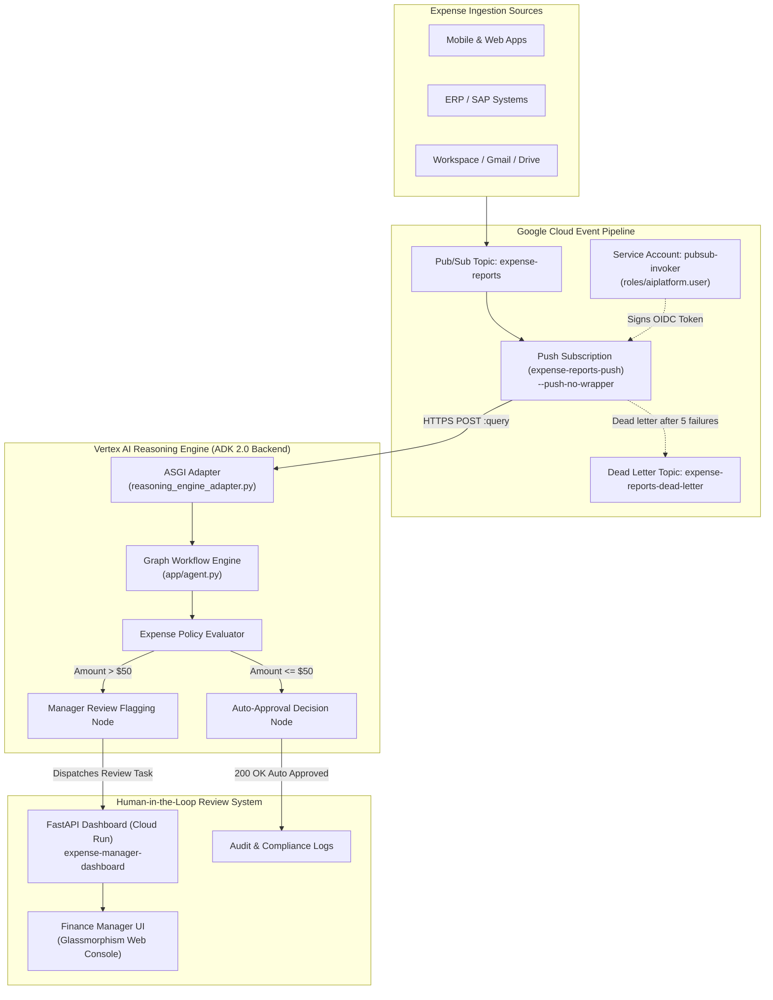
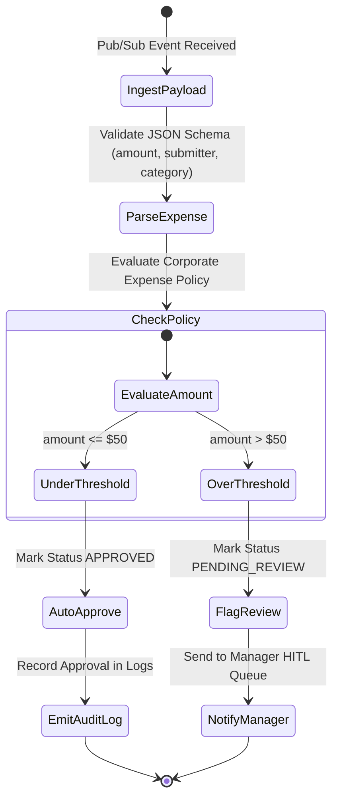

# System Architecture: Ambient Expense Claim & Approval Agent

An end-to-end intelligent corporate expense processing and auditing system built with **Google Agent Development Kit (ADK 2.0)**, **Vertex AI Reasoning Engine**, and **Cloud Run Human-in-the-Loop (HITL) Manager Dashboard**.

---

## 1. High-Level System Architecture

---

## 2. Decision Logic & Workflow Routing

The agent workflow is modeled as a state machine using Google ADK graph orchestration:

---

## 3. Vertex AI Reasoning Engine Adapter Pattern

### The Challenge
When Cloud Pub/Sub is configured with `--push-no-wrapper`, it sends incoming event payloads directly as JSON without the standard Vertex AI Reasoning Engine wrapper format (`{"class_method": "query", "input": {...}}`). Furthermore, ADK graph workflows only register streaming entrypoints (`async_stream_query`).

### The Solution: `reasoning_engine_adapter.py`
The ASGI adapter dynamically intercepts calls:
1. **Fallback Method Resolution:** If `class_method` is absent from the JSON body, it automatically falls back to the agent's primary query method.
2. **Synchronous Unwrapping:** If the underlying ADK workflow only registers `async_stream_query`, the adapter executes the asynchronous stream and returns the assembled final response synchronously to Pub/Sub with HTTP `200 OK` to acknowledge the message.

---

## 4. Security & Authentication Flow

1. **Ingress Restrictions:** Cloud Run dashboard adheres to organizational security policies with ingress configured for internal VPC and cloud load balancer.
2. **OIDC Authentication:** The Pub/Sub push subscription authenticates against Vertex AI Reasoning Engine using a dedicated Service Account (`pubsub-invoker`) with `roles/aiplatform.user` granted on the Google Cloud project.
3. **No Hardcoded Secrets:** Application Default Credentials (ADC) and Google Cloud metadata server manage all token exchanges automatically.
